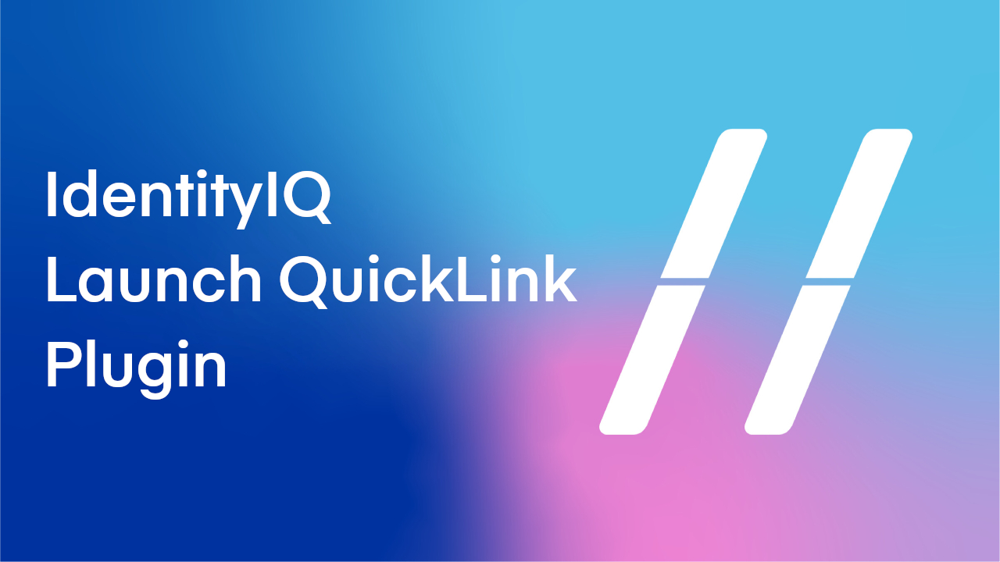
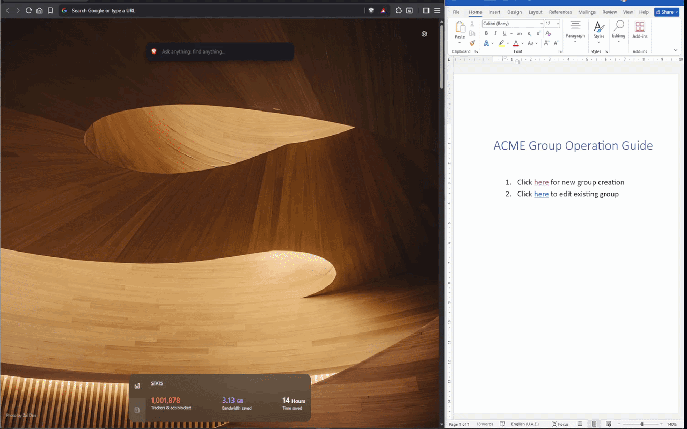
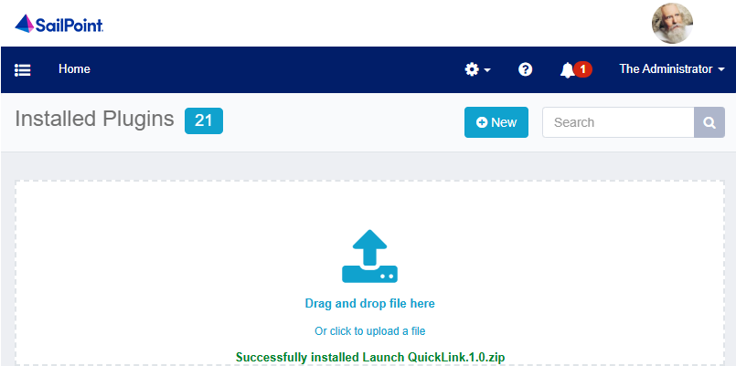
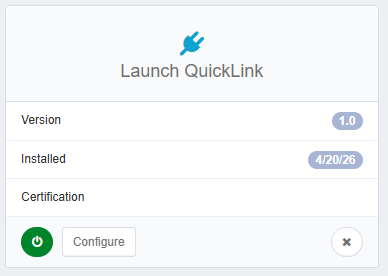

# Launch QuickLink

#### Plugin Name: - Launch QuickLink
#### Plugin Version: - 1.0
#### Supported version: - Identity IQ 8.0 or above 
#### Supported version: - Any Chromium or Firefox browser (Internet Explorer not supported)
#### Primary function: - This plugin can be used launch QuickLinks directly with URL.

## Demo

## Installation

* Simply drag and drop the plugin to install the plugin. 

## Configuration
Any available Quicklink in the navigation panel can be launched by constructing a URL following below pattern,

    https://iam.acme.com/identityiq/home.jsf?LaunchQL={QuickLink_Display_Name}

If the Quicklink supports For Me & For Others construct a URL following below pattern,

**To Launch For Me:-**

    https://iam.acme.com/identityiq/home.jsf?LaunchQL={QuickLink_Display_Name}

                                    Or

    https://iam.acme.com/identityiq/home.jsf?LaunchQL={QuickLink_Display_Name}&LaunchQLFor=Me

**To Launch For Others:-**

    https://iam.acme.com/identityiq/home.jsf?LaunchQL={QuickLink_Display_Name}&LaunchQLFor=Others

## Verification
*	Below example launches **Manage User Access/Request Access** QuickLink directly without navigation

        https://iam.acme.com/identityiq/home.jsf?LaunchQL=Manage User Access 

## Feedback
*	For bugs, feature enhancement requests, issues, or questions please contact me on [LinkedIn](https://www.linkedin.com/in/shandeepsrinivas/) or [c.shandeep@gmail.com](mailto:c.shandeep@gmail.com)
